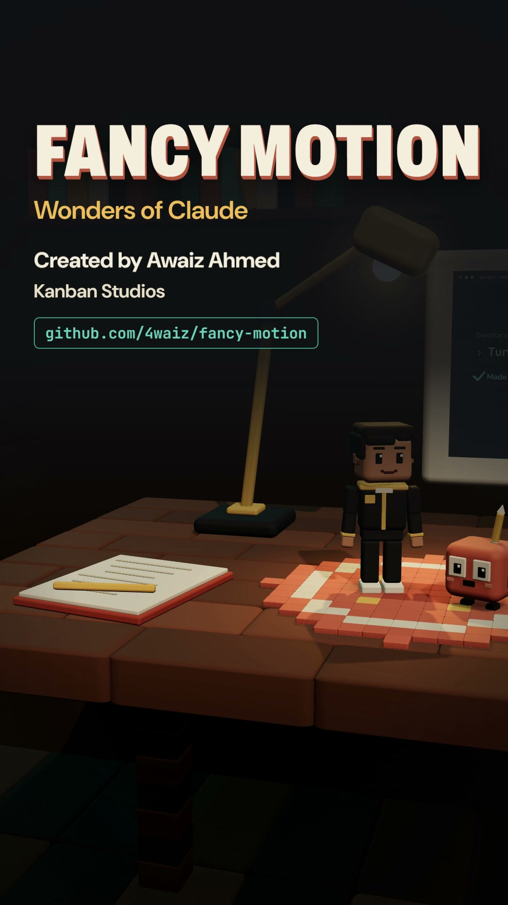

# Fancy Motion

**Created by Awaiz Ahmed · Kanban Studios**

A Claude Code skill that turns a creative brief into a finished, verified motion film: script,
storyboard, animation, captions, voiceover, sound design and final mix.

<p align="center">
  <a href="media/fancy-motion-30s.mp4"></a><br>
  <a href="media/fancy-motion-30s.mp4"><b>▶ Watch the 30-second film</b></a> — made with this skill
</p>

## Install

Copy the skill into your project (or into `~/.claude/skills/` to use it everywhere):

```bash
git clone https://github.com/4waiz/fancy-motion
cp -r fancy-motion/.claude/skills/fancy-motion <your-project>/.claude/skills/
```

Requirements: Node ≥ 22, FFmpeg on PATH, Python 3.12 + [uv](https://docs.astral.sh/uv/).

```bash
uv sync --project .claude/skills/fancy-motion/scripts --group qa
```

## Use

In Claude Code:

```text
/fancy-motion examples/mini-showcase
/fancy-motion "45-second explainer for our new export feature" --format vertical --creator "Your Name"
```

The first renders and verifies a bundled 8-second example. The second makes a new film:
brief → reference → script → storyboard → assets → rough render → review → refine → verify →
deliver, in landscape, vertical or square at 60 fps, with shorter social cuts as edit lists.

The CLI works on its own too: `node .claude/skills/fancy-motion/scripts/fm.mjs`
(`init · build · validate · render · mux · verify · review · inspect · sheet · status · install · example`).

Full workflow: [SKILL.md](.claude/skills/fancy-motion/SKILL.md) and its
[references](.claude/skills/fancy-motion/references/).
